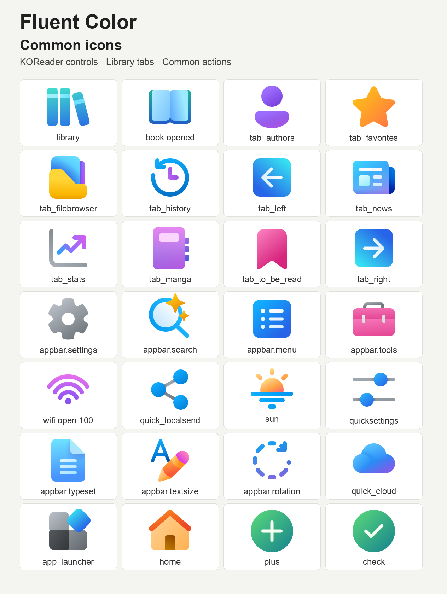
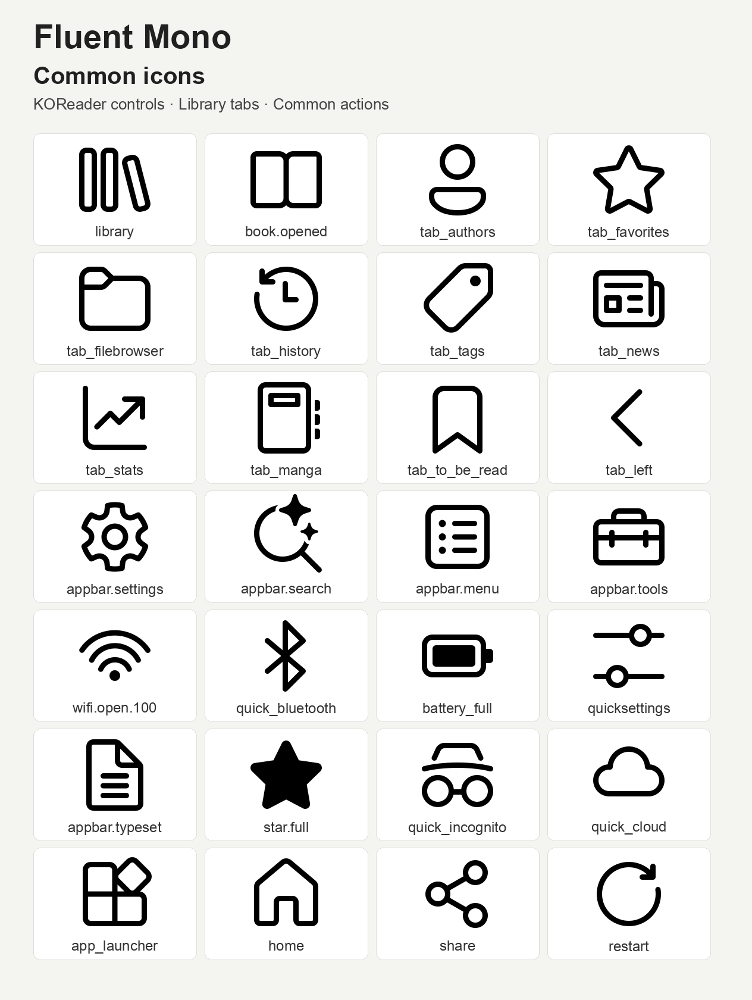

# Fluent Icon Packs for ZenOS

Replacement icons for [ZenOS](https://github.com/xZenLabs/zen-os), KOReader, and
ZenPM, packaged by [ZenLabs](https://github.com/xZenLabs) from
[Microsoft's Fluent Color icons](https://icon-sets.iconify.design/fluent-color/) and
[Fluent UI System Icons](https://icon-sets.iconify.design/fluent/).
This repository uses the [Zen icon pack template](https://github.com/xZenLabs/icon-pack-template)
and contains only Microsoft Fluent artwork.

## Icon overviews

### Fluent Color



### Fluent Mono



## What's included

Each variant is a standalone pack for ZenOS navigation and quick actions,
KOReader controls, and ZenPM categories and package actions. Color retains the
upstream color artwork and adds tinted Fluent filled shapes for missing controls.
Mono uses Fluent's regular outlines in black,
with a filled full-star state. Both retain native view boxes and path geometry;
selected arrows and markers are rotated or mirrored, and alpha variants reduce
opacity. Related actions may share a design.

| Pack | Source files | SVG lookups | Screen | Release asset |
|---|---|---|---|---|
| **Fluent Color** | 308 | 308 | Color e-ink | `zen-fluent-color.zip` |
| **Fluent Mono** | 358 | 358 | Black & white e-ink | `zen-fluent-mono.zip` |

Both variants cover all 50 ZenOS `quick_` controls and `tab_` icons, excluding
the blank spacer. Color uses Fluent filled moon, snooze, tag, battery, Bluetooth,
power, incognito, USB, fire, leaf, chess, puzzle, and RSS shapes with matching
gradients where the native Color collection has no design. Mono also covers
text alignment, column layouts, playback, and QR codes. Both variants can be used
on color or grayscale devices; choose the artwork you prefer.

Unavailable designs use ZenOS and KOReader's bundled artwork. Exact reading
direction and rotation states retain their bundled icons in both variants.
Mono supplies open Wi-Fi strength levels and full-strength secured Wi-Fi;
other secured signal levels retain the bundled artwork. Color has broader gaps,
including individual battery levels and weaker Wi-Fi signals. Every source name,
checksum,
transformation, and omitted source lookup is recorded in the
[Color source map](icon-sources.json) and
[Mono source map](Fluent%20Mono/icon-sources.json). Paths in these maps are
relative to the repository root. ZenOS status-bar font glyphs, downloaded package
logos, and package previews retain their own artwork.

ZenPM's frontend must support the selected ZenOS icon pack for replacements to
appear. Older frontends loading their bundled icons directly keep those icons.

Reader controls include `pin.svg`, `footnote.svg`, `return.svg`, and the
compatible `return_old.svg` lookup, alongside the highlight style, color,
delete, filter, and sort icons.

## Install with ZenPM

1. Open [ZenPM](https://github.com/xZenLabs/zen-pm) in KOReader and refresh sources.
2. If Fluent appears under **Categories → Icon Packs**, select
   `zen-fluent-color.zip` or `zen-fluent-mono.zip`, choose **Install**, and
   confirm queued changes.
3. Choose **Use icon pack** if offered, or select **Fluent Color for ZenOS**
   or **Fluent Mono for ZenOS** under
   **Zen Settings → Interface → Custom icons → Custom icon pack**.
4. Enable **Custom icons** and restart KOReader.

If the pack is not in your catalog, use the manual installation below.

## Manual installation

1. Download `zen-fluent-color.zip` or `zen-fluent-mono.zip` from
   [the latest release](https://github.com/xZenLabs/fluent-icon-pack/releases/latest).
2. Copy the ZIP into `koreader/icons/zen/`, creating the folders if needed.
3. Under **Zen Settings → Interface**, enable **Custom icons** and select
   **Fluent Color for ZenOS** or **Fluent Mono for ZenOS** under
   **Custom icons → Custom icon pack**.
4. Restart KOReader. ZenOS validates and extracts the ZIP automatically.

You can also extract the ZIP and copy its `zen-fluent-color` or `zen-fluent-mono`
folder into `koreader/icons/zen/`. Keep `pack.json` and the SVGs directly inside that folder.
See the [ZenOS icon-pack guide](https://github.com/xZenLabs/zen-os/blob/main/docs/icon-packs.md).

To switch packs, select another pack and restart. To restore bundled icons,
disable **Custom icons** and restart. After switching away, remove this pack
through ZenPM or delete its manually installed folder.

## Source layout

Each style keeps category folders directly beside `pack.json`.
Categories without replacement artwork can be absent:

```text
<Style>/
├── pack.json
├── navbar/
├── controls/                 # Quick settings and Zen controls
├── launcher/
├── zenpm/                    # Includes verification shields
├── lookup/
├── menus/                    # Zen menu entry points
├── reader/                   # Page browser: TOC, vocabulary, view modes
├── device/
├── settings/                 # Zen settings menu rows
└── koreader/                 # Stock KOReader icons, including plus/info
```

[ICON-LIST.md](ICON-LIST.md) lists the filenames by category. Page-browser TOC, vocabulary-builder,
and view icons belong in `reader/`. All stock KOReader icons, including `appbar.*`,
the Aa font button, plus/info, bookmarks, and `book_open`, belong in `koreader/`. Quick settings
belong in `controls/`; `tab_left` and `tab_right` belong in `navbar/`.
Shared lookup names appear only once per style;
different lookup names can be edited independently.

Legacy SimpleUI `qa_group` and `qa_plugin` files are omitted. ZenPM uses
`plugin.svg`; its verification shields belong in `zenpm/`.
The builder flattens the categories into the pack root in release ZIPs,
so installed lookup names and artwork remain unchanged apart from the two
obsolete SimpleUI names. Missing icons keep their normal bundled fallbacks.

## Building and checking

Each pack manifest includes `"color": true` for colour artwork or
`"color": false` for monochrome artwork. Per-style values are retained in the
release ZIPs when building the whole repository.

Lookups use suitable native artwork or related Fluent shapes.
The existing Python builder copies the grouped source SVGs unchanged,
checks assets and archive limits, and writes a standalone ZIP. No Lua is needed.

```sh
python3 -m venv .venv
source .venv/bin/activate
python3 -m pip install -r scripts/requirements.txt
python3 -m unittest discover -s scripts -p 'test_*.py'
python3 scripts/build-zen-packs.py
```

The outputs are `dist/zen-fluent-color.zip` and `dist/zen-fluent-mono.zip`.
To build a style folder directly or override the release version:

```sh
python3 scripts/build-zen-packs.py "Fluent Color" --output dist --version 1.0.0
python3 scripts/build-zen-packs.py "Fluent Mono" --output dist --version 1.0.0
```

Root `pack.json` supplies shared version and author metadata. Each style folder
includes its own ID and display name for direct builds. `--version` overrides
the build version.
SVGs are parsed and validated but are not sanitized. The template's generic
builder also supports partial extracted SimpleUI packs and verified PNG inputs.

## Releases

**Actions → Release Zen icon packs** runs on pushes to `main` and manually.
It runs the tests, builds both packs, checks their shared release version, and
publishes both ZIPs in the same release.
A pushed increase in root `pack.json` releases that exact version. Otherwise
the workflow increments the patch above the higher of the manifest and existing
release tags. Release runs are serialized. The initial source version is `1.0.0`.

## Credits and license

- **Icons:** Microsoft's [Fluent Color](https://icon-sets.iconify.design/fluent-color/)
  and [Fluent UI System Icons](https://icon-sets.iconify.design/fluent/) sets,
  licensed under **MIT**.
- **Sources:** [Color](https://github.com/iconify/icon-sets/blob/c455eb6232ac0fa657550afb512af55fb8237ed6/json/fluent-color.json)
  and [Mono](https://github.com/iconify/icon-sets/blob/c455eb6232ac0fa657550afb512af55fb8237ed6/json/fluent.json),
  both pinned to Iconify revision `c455eb6232ac`.
- **Packaging:** [ZenLabs](https://github.com/xZenLabs), using the
  [Zen icon pack template](https://github.com/xZenLabs/icon-pack-template).
- **Repository code:** AGPL-3.0; see [LICENSE](LICENSE). Icon licensing is separate;
  retain [LICENSE-ICONS.txt](LICENSE-ICONS.txt) when redistributing the pack.

Changes are limited to standalone SVG wrappers, lookup filenames, selected
rotations, mirroring and opacity, explicit black currentColor for Mono, and
editable lookup aliases.
Not affiliated with or endorsed by Microsoft, KOReader, or Iconify.

## Support

Report problems or request mappings through
[repository issues](https://github.com/xZenLabs/fluent-icon-pack/issues).
Support ZenLabs projects on [Ko-fi](https://ko-fi.com/xzenlabs).
